 

**Olá! 👋 Bem-vindo ao meu perfil.**

Sou estudante de **Análise e Desenvolvimento de Sistemas no IFBA**, construindo minha base em programação e explorando o universo da tecnologia. Gosto de aprender, experimentar e entender o que existe por trás das ferramentas que utilizo.

 

---

### ✦ Um pouco sobre mim

- 🎓 Cursando **Análise e Desenvolvimento de Sistemas** no **Instituto Federal da Bahia (IFBA)**.
- 📖 Aprendendo **programação em C, lógica de programação e algoritmos**.
- 🐧 Tenho interesse em **Linux**, ferramentas de desenvolvimento e no funcionamento dos sistemas.
- 🌱 Meu objetivo é evoluir com consistência, praticando os fundamentos antes de dar passos maiores.

### ✦ O que faz parte da minha jornada

| 📚 Em aprendizado | 🛠️ Ferramentas e ambiente |
| :---: | :---: |
|   |    |
| **Lógica · Algoritmos · Fundamentos** | **Terminal · Versionamento · Ambiente Linux** |

### ✦ Minha atividade no GitHub

  
   
  

---

*Aprendendo um pouco mais a cada dia.* ✨

